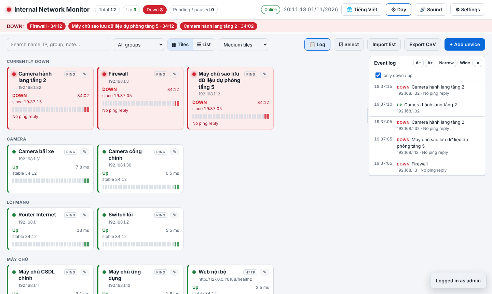
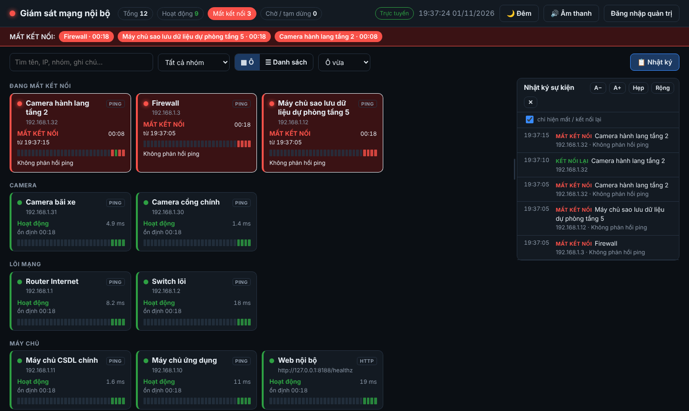
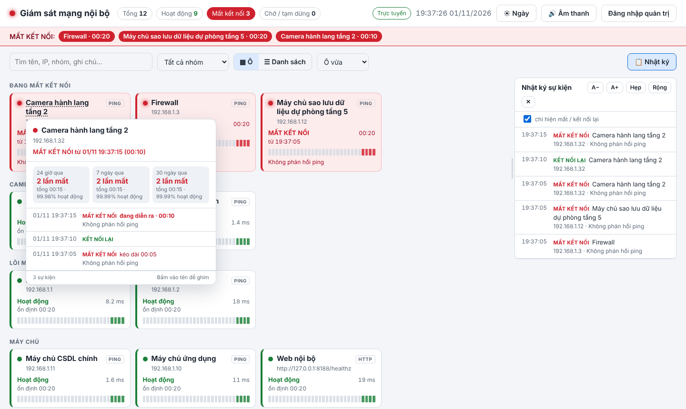

# pingmon – Internal network monitor with audible alerts

[🇻🇳 Tiếng Việt](README.md) · 🇬🇧 English

A web dashboard that monitors **Ping / TCP port / HTTP(S) / DNS** for devices on your internal network. When a device **goes down** or **comes back up**, every browser that has the page open **plays an alert sound**, **reads the device name aloud** and shows a notification. It is designed for a duty desk: leave the page open on a screen and you will hear problems as they happen.

- **One container** (`python:3.12-alpine`). The server uses only the Python standard library, so there is no `pip install`.
- **One-command install** with `./installer`: it installs Docker if needed, creates an HTTPS certificate, generates an admin password and starts the service.
- SQLite storage, Vietnamese and English user interface, day and night themes.



| Night theme | Device history on hover |
|---|---|
|  |  |

---

## Features

**Monitoring**
- Four check types:
  - **Ping (ICMP)**
  - **TCP port**
  - **HTTP(S)**: any status code below 500 counts as up
  - **DNS**: sends an A-record query to the DNS server
- Check interval, timeout, and the number of consecutive failures before a device is reported down are all configurable, so a single lost packet does not raise an alarm.
- Each device shows its latency, packet loss, how long it has been up or down, and a strip of its last 30 checks.

**Alerts**
- A sound plays **whenever a device changes state**:
  - 13 "down" sounds: hi-lo alert, sirens, ambulance, fire bell, klaxon, sonar, gong…
  - 9 "up" sounds.
  - Or a **custom sound file** (mp3/wav, up to 1.5 MB).
  - Repeat count and volume are adjustable.
- **Text-to-speech** reads the device name aloud, e.g. *"Down: Floor 3 switch"*. It uses an English voice in English mode and a Vietnamese voice in Vietnamese mode.
- On-screen notifications, a flashing tile, a red bar listing the devices that are down, and a red browser-tab icon.
- An optional **reminder** every 1, 5, 10 or 30 minutes while any device is still down.
- If the browser loses its connection to the monitoring server for more than 15 seconds, the page turns yellow and plays a warning sound.

**Management**
- Anyone on the network can **view and hear** alerts. **Adding, editing and deleting** devices requires the admin password.
- **Bulk import:** paste from Excel, or **paste raw network-scan output** (`IP  2 ms  HOSTNAME`). There is an option to *replace the whole list*.
- **Multi-select** to delete, pause, resume or move devices to a group. **Delete all** asks you to type `DELETE` first.
- Export the device list to CSV.

**Interface**
- **Tiles** view (four sizes) and **List** view (table). Long device names are shown in full.
- **Day / Night / Auto** theme. Auto uses the day theme from 06:00 to 18:00.
- **Hover a device name** to see its own history: outage count, total downtime and % uptime for the last 24 hours, 7 days and 30 days, plus how long each outage lasted. Click the name to pin the panel.
- The **event log** panel can be shown or hidden, its text size changed, and its width adjusted by dragging.
- **Language:** use the 🌐 button, or open `https://<DOMAIN>/?lang=en`. The choice is saved per browser.

## Requirements

- A Linux server with Docker and Docker Compose v2. On Ubuntu/Debian the installer can install them for you.
- Ports **80** and **443** free, or choose other ports (see below).
- The server must be able to reach the devices you monitor, and to pull `python:3.12-alpine` from Docker Hub.

## Quick start

```bash
git clone <repo-url> pingmon-src
cd pingmon-src
chmod +x installer
sudo DOMAIN=monitor.example.com IP=192.168.1.100 ./installer
```

The installer:
1. Checks the OS and installs Docker if it is missing.
2. Checks ports 80/443. If another container is using them, it **asks before stopping** that container.
3. Writes the application to `~/pingmon` (change this with `TARGET`).
4. Generates a random admin password and stores it in `~/pingmon/.env`.
5. Creates a **10-year self-signed HTTPS certificate** whose SAN covers the domain, hostname and IP.
6. Starts the container, waits until the site responds, and test-pings from inside the container.
7. Prints the URL and the admin password.

> The `installer` file contains all the source code, so copying that **single file** to the server is enough.

### Installer variables

| Variable | Meaning |
|---|---|
| `DOMAIN` | Hostname used to reach the site (written into the certificate) |
| `IP` | Server IP (written into the certificate and used for the test ping) |
| `HOST_NAME` | Server hostname (written into the certificate) |
| `HTTP_PORT` / `HTTPS_PORT` | Published ports, e.g. `HTTP_PORT=8080 HTTPS_PORT=8443` |
| `TARGET` | Install directory (default `~/pingmon`) |
| `AUTO_STOP=1` | Stop containers that occupy the ports without asking |

Defaults are set at the top of `installer` and `tools/build_installer.py`.

## Usage

1. Open `https://<DOMAIN>`, click **Admin login** and enter the password. `./installer password` shows it again.
2. Click **+ Add device**, or **Import list** to add many devices at once.

Import format, one device per line: `Name, IP, Group, Type, Port/URL/Domain`. Only `Name, IP` is required, and the type defaults to Ping.

```text
Core switch, 192.168.1.2, Core
Intranet web, 192.168.1.20, Servers, http, https://192.168.1.20/
Remote Desktop, 192.168.1.21, Servers, tcp, 3389
Internal DNS, 192.168.1.5, Servers, dns, example.local
192.168.1.50	2 ms	PRINTER-T1        ← raw scan output: the hostname becomes the name
```

### Duty-desk screen

Browsers block sound until the user has clicked on the page. Either click **"Click to enable sound alerts"** once, or start Chrome in kiosk mode from `shell:startup`:

```text
"C:\Program Files\Google\Chrome\Application\chrome.exe" --kiosk --autoplay-policy=no-user-gesture-required https://<DOMAIN>
```

Also turn off sleep and the screen timeout on the duty PC, and check that the speakers are on.

### HTTPS certificate

Install `~/pingmon/pingmon.crt` into **Trusted Root Certification Authorities** on each workstation, either with `certutil -addstore -f Root pingmon.crt` (run as Administrator) or through Group Policy. Firefox uses its own certificate store, so import the certificate there too. To use a certificate from your own CA, replace `ssl/pingmon.crt` and `ssl/pingmon.key`, then run `./installer restart`.

## Operations

```bash
./installer            # install / update (keeps data, password, certificate)
./installer status     # container status
./installer logs       # server logs
./installer password   # show admin password
./installer restart    # restart
./installer uninstall  # remove container (data is kept)
```

- **Upgrade:** replace the `installer` file, run `./installer`, then press Ctrl+F5 in every open browser.
- **Change the admin password:** edit `ADMIN_PASSWORD=` in `~/pingmon/.env`, then run `./installer restart`.
- **Backup:** `~/pingmon/data/pingmon.db` (devices and events), plus `.env` and `ssl/`. Events older than 180 days are removed automatically.

## Development

```text
installer                 # generated by tools/build_installer.py – do not edit by hand
docker-compose.yml
app/app.py                # server: checks, SQLite, JSON API, HTTPS (standard library only)
app/index.html            # UI: plain HTML/CSS/JS, sounds generated with WebAudio, vi/en strings
tools/build_installer.py  # bundles docker-compose.yml + app/ into ./installer
```

After changing `app/` or `docker-compose.yml`, run `python3 tools/build_installer.py` and commit the regenerated `installer`.

Run locally on Linux without Docker or certificates:
```bash
cd app && ADMIN_PASSWORD=test DATA_DIR=./data PORT=8080 python3 app.py   # http://localhost:8080
```

To add a translation, add entries to the `EN` dictionary (and `EN_HTML` / `SRV_EN`) near the top of the second `<script>` in `app/index.html`. The Vietnamese text is the lookup key, and any missing entry falls back to Vietnamese.

## API

All responses are JSON. `POST` requests need `Content-Type: application/json` and the admin session cookie (except `/api/login`).

| Method | Path | Description |
|---|---|---|
| GET | `/api/state?since=<id>` | All devices plus events newer than `since` |
| GET | `/api/history?id=<id>` | Device history and 24 h / 7 d / 30 d statistics |
| GET | `/api/export` | Device list as CSV (admin) |
| GET | `/healthz` | Health check |
| POST | `/api/login` / `/api/logout` | `{"password": "..."}` |
| POST | `/api/device/save` | Create a device (no `id`) or update one (with `id`) |
| POST | `/api/device/delete` | `{"id": 5}` · `{"ids": [1,2]}` · `{"all": true}` |
| POST | `/api/device/bulk` | `{"ids": [...], "action": "pause\|resume\|group", "grp": "..."}` |
| POST | `/api/import` | `{"text": "...", "grp": "default group", "replace": false}` |
| POST | `/api/settings` | `{"interval", "timeout", "fail_threshold", "ok_threshold", "title"}` |

Server messages, such as check errors and API errors, are returned in Vietnamese and translated in the browser when English is selected.

## Troubleshooting

| Symptom | Fix |
|---|---|
| *Port 80/443 is in use* | Answer `Y` to stop the container that uses it, or run with `HTTP_PORT=8080 HTTPS_PORT=8443` |
| Every device shows as down | Run `docker exec pingmon ping -c1 <IP>`. A permission error means `cap_add: NET_RAW` is missing; otherwise check the server's routing and firewall |
| Hostname checks fail with *Cannot resolve name* | Uncomment `dns:` in `docker-compose.yml` and set your internal DNS server, or use IP addresses |
| No sound | Click the page once, or run Chrome with `--autoplay-policy=no-user-gesture-required`. Check that the 🔊 button is not *Muted*, and check the volume and speakers |
| Sound plays but names are not read | Install a voice for the selected language in the operating system |
| Browser shows *Not secure* | Install `pingmon.crt` as a trusted root on the workstation |
| The UI did not update after an upgrade | Press Ctrl+F5 |
