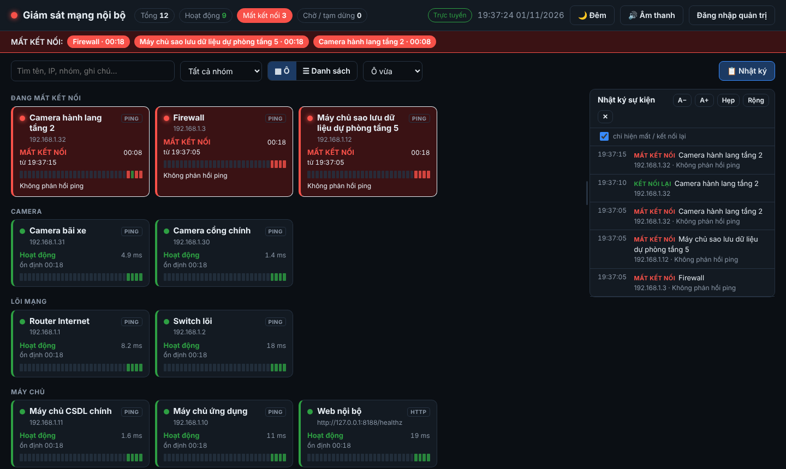
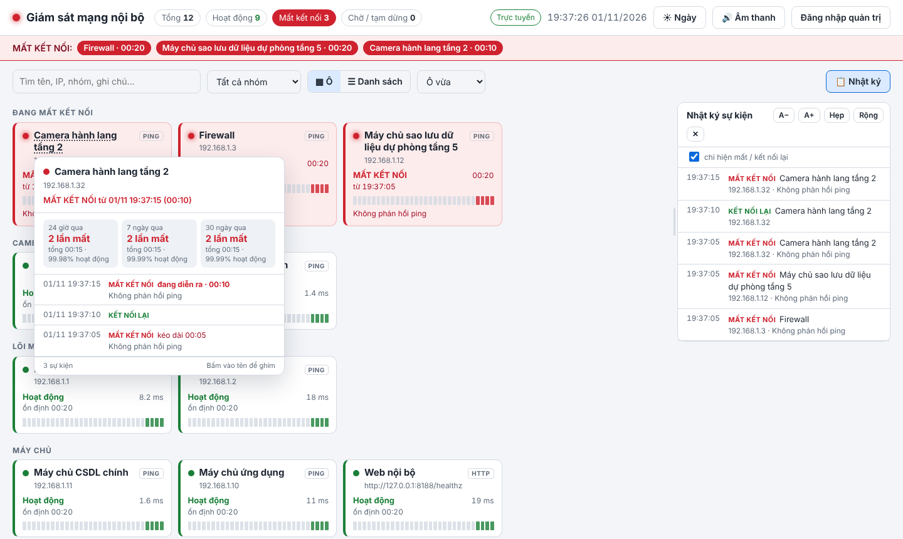
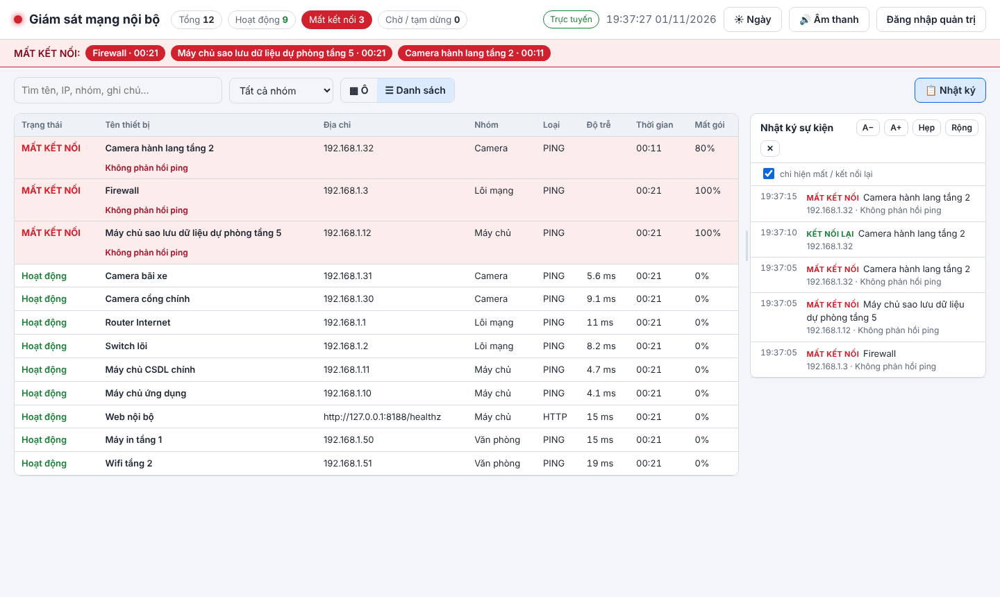
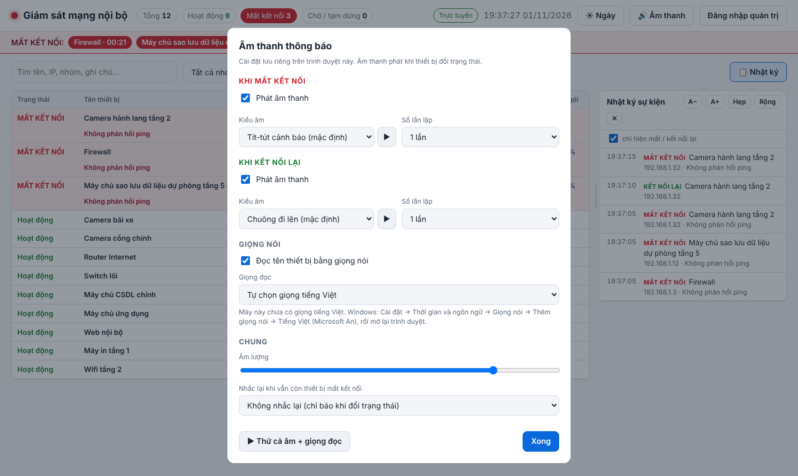
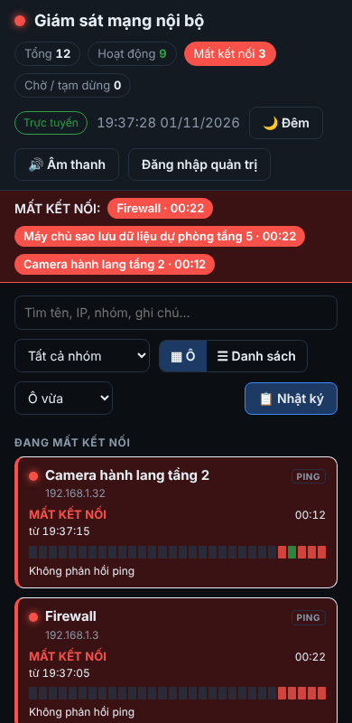

# pingmon – Website giám sát mạng nội bộ có cảnh báo âm thanh

🇻🇳 Tiếng Việt · [🇬🇧 English](README.en.md)

Website giám sát **Ping / cổng TCP / HTTP(S) / DNS** cho các thiết bị trong mạng nội bộ. Khi thiết bị **mất kết nối** hoặc **kết nối lại**, mọi trình duyệt đang mở trang sẽ **phát âm báo**, **đọc tên thiết bị bằng giọng tiếng Việt** và hiện thông báo trên màn hình. Phần mềm được làm cho bàn trực: mở sẵn trên một màn hình, có sự cố là nghe thấy ngay.

- Chỉ **1 container** (`python:3.12-alpine`), chỉ dùng thư viện chuẩn Python, không cần `pip install`.
- Cài bằng **1 lệnh**: `./installer`. Script tự cài Docker, tạo chứng chỉ HTTPS, sinh mật khẩu quản trị và khởi động.
- Dữ liệu lưu trong SQLite, giao diện tiếng Việt, có chế độ ngày và đêm.



| Giao diện ngày + lịch sử thiết bị | Chế độ danh sách |
|---|---|
|  |  |

| Cài đặt âm thanh | Điện thoại |
|---|---|
|  |  |

---

## Mục lục
- [Tính năng](#tính-năng)
- [Yêu cầu](#yêu-cầu)
- [Cài đặt nhanh](#cài-đặt-nhanh)
- [Cấu hình](#cấu-hình)
- [Sử dụng](#sử-dụng)
- [Máy trực (màn hình cảnh báo)](#máy-trực-màn-hình-cảnh-báo)
- [Chứng chỉ HTTPS](#chứng-chỉ-https)
- [Vận hành](#vận-hành)
- [Cấu trúc mã nguồn](#cấu-trúc-mã-nguồn)
- [API](#api)
- [Khắc phục sự cố](#khắc-phục-sự-cố)

---

## Tính năng

**Giám sát**
- 4 loại kiểm tra: **Ping (ICMP)**, **cổng TCP**, **HTTP(S)** (mã trả về < 500 coi là hoạt động), **DNS** (gửi truy vấn bản ghi A tới máy chủ DNS).
- Chu kỳ kiểm tra, thời gian chờ và số lần lỗi liên tiếp trước khi báo đều chỉnh được, nên tránh báo nhầm khi chỉ mất một gói tin.
- Mỗi thiết bị hiện độ trễ, % mất gói, thời gian ổn định hoặc thời gian mất kết nối, và một dải 30 lần kiểm tra gần nhất.

**Cảnh báo**
- Âm báo **khi thiết bị đổi trạng thái**:
  - 13 kiểu âm khi mất kết nối: tít‑tút, còi hú, còi cảnh sát, cứu thương, báo cháy, klaxon, sonar, cồng…
  - 9 kiểu âm khi kết nối lại.
  - Hoặc dùng **tệp âm thanh riêng** (mp3/wav ≤ 1,5 MB).
  - Chọn được số lần lặp và âm lượng.
- **Đọc tên thiết bị** bằng giọng tiếng Việt, ví dụ: *"Mất kết nối: Switch tầng 3"*.
- Hiện thông báo góc màn hình, ô thiết bị nháy viền, thanh đỏ liệt kê các thiết bị đang mất kết nối, biểu tượng tab chuyển sang đỏ.
- Tuỳ chọn **nhắc lại** sau mỗi 1, 5, 10 hoặc 30 phút khi vẫn còn thiết bị mất kết nối.
- Trình duyệt **mất kết nối tới máy chủ giám sát** quá 15 giây thì trang chuyển sang màu vàng và phát âm cảnh báo.

**Quản lý**
- Ai trong mạng cũng **xem và nghe** được. **Thêm / sửa / xoá** thiết bị cần đăng nhập quản trị.
- **Nhập hàng loạt:** dán từ Excel, hoặc **dán nguyên kết quả quét mạng** (`IP  2 ms  HOSTNAME`). Có tuỳ chọn *xoá danh sách cũ rồi nhập mới*.
- **Chọn nhiều** thiết bị để xoá, tạm dừng, tiếp tục hoặc chuyển nhóm. Có **Xoá tất cả** (phải gõ `XOA` để xác nhận).
- Xuất danh sách thiết bị ra CSV.

**Giao diện**
- Hai chế độ xem: **Ô** (4 cỡ) và **Danh sách** (dạng bảng). Tên dài hiển thị đầy đủ.
- **Ngày / Đêm / Tự động:** chế độ Tự động dùng giao diện ngày từ 6:00 đến 18:00.
- **Trỏ chuột vào tên thiết bị** để xem lịch sử riêng của thiết bị đó: số lần mất kết nối, tổng thời gian mất, % hoạt động trong 24 giờ / 7 ngày / 30 ngày, và mỗi lần mất kéo dài bao lâu. Bấm vào tên để ghim ô lịch sử.
- Khung **nhật ký sự kiện** ẩn/hiện được, đổi cỡ chữ được, kéo để chỉnh độ rộng.
- Lọc theo nhóm, theo trạng thái, hoặc tìm theo tên, IP, ghi chú. Hiển thị tốt trên điện thoại.
- **Hai ngôn ngữ: Tiếng Việt / English** (nút 🌐 trên thanh tiêu đề, hoặc mở `https://<DOMAIN>/?lang=en`). Ngôn ngữ lưu riêng trên từng trình duyệt; ở chế độ English, giọng đọc dùng giọng tiếng Anh.

---

## Yêu cầu

- Máy chủ Linux có Docker và Docker Compose v2. Nếu chưa có, installer tự cài trên Ubuntu/Debian.
- Cổng **80** và **443** còn trống. Nếu đã bị chiếm, chọn cổng khác (xem [Cấu hình](#cấu-hình)).
- Máy chủ đi được tới các thiết bị cần giám sát, và tải được image `python:3.12-alpine` từ Docker Hub.
- Trình duyệt trên máy trực: Chrome, Edge hoặc Firefox bản mới.

## Cài đặt nhanh

```bash
git clone <địa-chỉ-repo> pingmon-src
cd pingmon-src
chmod +x installer
sudo ./installer
```

Installer sẽ:
1. Kiểm tra hệ điều hành và cài Docker nếu chưa có.
2. Kiểm tra cổng 80/443. Nếu một container khác đang dùng cổng, installer **hỏi trước** khi dừng container đó.
3. Ghi mã nguồn vào `~/pingmon` (đổi được bằng biến `TARGET`).
4. Sinh **mật khẩu quản trị** ngẫu nhiên, lưu trong `~/pingmon/.env`.
5. Tạo **chứng chỉ HTTPS tự ký 10 năm**, có SAN gồm tên miền, hostname và IP.
6. Khởi động container, chờ website sẵn sàng, ping thử từ trong container ra ngoài.
7. In ra địa chỉ website và mật khẩu quản trị.

> File `installer` chứa sẵn toàn bộ mã nguồn, nên chỉ cần chép đúng **một file này** lên máy chủ là cài được.

## Cấu hình

Truyền biến môi trường khi chạy installer:

| Biến | Ý nghĩa | Ví dụ |
|---|---|---|
| `DOMAIN` | Tên miền truy cập website, ghi vào chứng chỉ | `DOMAIN=monitor.example.vn` |
| `IP` | IP máy chủ, ghi vào chứng chỉ và dùng để ping thử | `IP=192.168.1.100` |
| `HOST_NAME` | Hostname máy chủ, ghi vào chứng chỉ | `HOST_NAME=srv-monitor` |
| `HTTP_PORT` / `HTTPS_PORT` | Cổng publish ra ngoài | `HTTP_PORT=8080 HTTPS_PORT=8443` |
| `TARGET` | Thư mục cài đặt | `TARGET=/opt/pingmon` |
| `AUTO_STOP=1` | Tự dừng container đang chiếm cổng mà không hỏi | |

```bash
sudo DOMAIN=monitor.example.vn IP=192.168.1.100 ./installer
```

Giá trị mặc định nằm ở đầu file `installer` và `tools/build_installer.py`. Cổng đã chọn được lưu vào `.env`, nên những lần chạy sau không cần nhập lại.

Các thông số giám sát chỉnh ngay trên web, ở mục **⚙ Cài đặt** (cần đăng nhập quản trị):

| Thông số | Mặc định |
|---|---|
| Chu kỳ kiểm tra | 10 giây |
| Thời gian chờ | 2 giây |
| Số lần lỗi liên tiếp trước khi báo mất kết nối | 3 (khoảng 30 giây) |
| Số lần thành công liên tiếp trước khi báo kết nối lại | 1 |

## Sử dụng

1. Mở `https://<DOMAIN>`, bấm **Đăng nhập quản trị** và nhập mật khẩu. Xem lại mật khẩu bằng `./installer password`.
2. Bấm **+ Thêm thiết bị**, hoặc **Nhập danh sách** để thêm nhiều thiết bị một lúc.

### Định dạng nhập danh sách

Mỗi dòng một thiết bị: `Tên, IP, Nhóm, Loại, Cổng/URL/Tên miền`. Chỉ hai cột `Tên, IP` là bắt buộc, loại mặc định là Ping. Dấu phân cách có thể là phẩy, chấm phẩy hoặc tab (dán thẳng từ Excel được).

```text
Switch lõi, 192.168.1.2, Lõi mạng
Web nội bộ, 192.168.1.20, Máy chủ, http, https://192.168.1.20/
Remote Desktop, 192.168.1.21, Máy chủ, tcp, 3389
DNS nội bộ, 192.168.1.5, Máy chủ, dns, example.local
192.168.1.50	2 ms	PRINTER-T1        ← kết quả quét mạng: tự lấy hostname làm tên
```

File mẫu: [`docs/thiet-bi-mau.txt`](docs/thiet-bi-mau.txt).

### Thao tác thường dùng

| Việc cần làm | Cách làm |
|---|---|
| Sửa thiết bị | Bấm ✎ ở góc ô, hoặc nút **Sửa** cuối hàng ở chế độ Danh sách |
| Xoá / tạm dừng nhiều thiết bị | **☑ Chọn nhiều**, chọn thiết bị, rồi chọn thao tác trên thanh màu xanh |
| Thay toàn bộ danh sách | **Nhập danh sách**, tích *Xoá toàn bộ thiết bị hiện có*. Nếu danh sách mới không có dòng hợp lệ thì danh sách cũ được giữ nguyên |
| Xem lịch sử một thiết bị | Trỏ chuột vào tên. Bấm vào tên để ghim, nhấn Esc để đóng |
| Đổi âm báo | Nút **🔊 Âm thanh**. Lựa chọn lưu riêng trên từng trình duyệt |
| Đổi giao diện | Nút **🌙 Đêm / ☀ Ngày / 🕒 Tự động** |
| Đổi ngôn ngữ | Nút **🌐 English / 🌐 Tiếng Việt**, hoặc thêm `?lang=en` / `?lang=vi` vào địa chỉ |

## Máy trực (màn hình cảnh báo)

Trình duyệt chặn phát âm thanh khi người dùng chưa bấm vào trang. Có hai cách xử lý:

- **Bấm tay:** mở trang và bấm **"Bấm để bật âm thanh thông báo"** một lần mỗi khi mở trình duyệt.
- **Tự động (khuyên dùng):** tạo shortcut trong thư mục `shell:startup` của Windows:

  ```text
  "C:\Program Files\Google\Chrome\Application\chrome.exe" --kiosk --autoplay-policy=no-user-gesture-required https://<DOMAIN>
  ```

**Giọng đọc tiếng Việt trên Windows 10/11:** vào *Cài đặt → Thời gian và ngôn ngữ → Giọng nói → Thêm giọng nói → Tiếng Việt* (Microsoft An), rồi mở lại trình duyệt. Nếu máy chưa có giọng Việt, trang vẫn phát âm báo bình thường, chỉ không đọc tên.

Ngoài ra nên tắt chế độ ngủ và tắt tự tắt màn hình của máy trực, đồng thời kiểm tra loa đã bật.

## Chứng chỉ HTTPS

- Installer tạo **chứng chỉ tự ký** tại `~/pingmon/ssl/` và chép thêm một bản ra `~/pingmon/pingmon.crt` để cài lên máy trạm.
- Cài chứng chỉ vào *Trusted Root* trên máy trạm Windows (CMD quyền Administrator):
  ```bat
  certutil -addstore -f Root pingmon.crt
  ```
  Nếu nhiều máy, có thể phân phối qua GPO: *Computer Configuration → Policies → Windows Settings → Security Settings → Public Key Policies → Trusted Root Certification Authorities*.
- Firefox dùng kho chứng chỉ riêng: import trong *Settings → Certificates*, hoặc bật policy `security.enterprise_roots.enabled`.
- Muốn dùng chứng chỉ của CA nội bộ thì thay hai file `ssl/pingmon.crt` và `ssl/pingmon.key`, rồi chạy `./installer restart`.

## Vận hành

```bash
./installer            # cài đặt / cập nhật (giữ nguyên dữ liệu, mật khẩu, chứng chỉ)
./installer status     # trạng thái container
./installer logs       # nhật ký máy chủ (Ctrl+C để thoát)
./installer password   # xem mật khẩu quản trị
./installer restart    # khởi động lại
./installer uninstall  # gỡ container (vẫn giữ dữ liệu)
```

**Cập nhật phiên bản mới:** chép file `installer` mới đè lên file cũ, chạy `./installer`, rồi nhấn **Ctrl+F5** trên các trình duyệt đang mở trang.

**Đổi mật khẩu quản trị:** sửa dòng `ADMIN_PASSWORD=` trong `~/pingmon/.env`, rồi chạy `./installer restart`.

**Sao lưu:**
```bash
cp ~/pingmon/data/pingmon.db ~/pingmon-$(date +%F).db     # danh sách thiết bị + nhật ký sự kiện
cp ~/pingmon/.env ~/pingmon/ssl/* /noi-sao-luu/            # mật khẩu + chứng chỉ
```
Nhật ký sự kiện cũ hơn 180 ngày được tự động xoá.

## Cấu trúc mã nguồn

```text
.
├── installer                 # File cài đặt 1 lệnh (sinh từ tools/build_installer.py – không sửa tay)
├── docker-compose.yml        # 1 dịch vụ: pingmon (python:3.12-alpine, cap NET_RAW để ping)
├── app/
│   ├── app.py                # Máy chủ: kiểm tra Ping/TCP/HTTP/DNS, SQLite, API, HTTPS (chỉ thư viện chuẩn)
│   └── index.html            # Giao diện web (HTML/CSS/JS thuần, âm thanh tạo bằng WebAudio)
├── tools/
│   └── build_installer.py    # Đóng gói docker-compose.yml + app/ vào file installer
└── docs/                     # Ảnh màn hình, danh sách mẫu
```

Trên máy chủ sau khi cài:

```text
~/pingmon/
├── .env                      # ADMIN_PASSWORD, HTTP_PORT, HTTPS_PORT
├── docker-compose.yml
├── app/                      # mã nguồn (mount read-only vào container)
├── data/pingmon.db           # CSDL SQLite
├── ssl/pingmon.crt|.key      # chứng chỉ HTTPS
└── pingmon.crt               # bản sao chứng chỉ để cài lên máy trạm
```

**Phát triển:** sau khi sửa `app/` hoặc `docker-compose.yml`, chạy lại script đóng gói rồi commit cả file `installer`:
```bash
python3 tools/build_installer.py
```

Chạy thử trên máy cá nhân, không cần Docker và không cần chứng chỉ:
```bash
cd app && ADMIN_PASSWORD=test DATA_DIR=./data PORT=8080 python3 app.py
# mở http://localhost:8080   (chạy trên Linux; lệnh ping phải dùng được không cần sudo)
```

**Biến môi trường của `app.py`:**

| Biến | Mặc định | Ý nghĩa |
|---|---|---|
| `ADMIN_PASSWORD` | (trống = ai cũng sửa được) | Mật khẩu quản trị |
| `DATA_DIR` | `./data` | Thư mục chứa `pingmon.db` |
| `CERT_FILE`, `KEY_FILE` | | Có cả hai thì chạy HTTPS + chuyển hướng HTTP |
| `HTTPS_LISTEN`, `HTTP_LISTEN` | `443`, `80` | Cổng lắng nghe bên trong container |
| `PUBLIC_HTTPS_PORT` | `443` | Cổng dùng khi chuyển hướng HTTP → HTTPS |
| `PORT` | `8080` | Cổng HTTP khi không có chứng chỉ |
| `PING_CMD` | `ping` | Lệnh ping |
| `WORKERS` | `64` | Số luồng kiểm tra song song |

## API

Mọi phản hồi đều là JSON. Các lệnh `POST` cần header `Content-Type: application/json` và cookie đăng nhập quản trị (trừ `/api/login`).

| Phương thức | Đường dẫn | Mô tả |
|---|---|---|
| GET | `/api/state?since=<id>` | Trạng thái toàn bộ thiết bị + sự kiện có id lớn hơn `since` |
| GET | `/api/history?id=<id>` | Lịch sử và thống kê 24 giờ / 7 ngày / 30 ngày của một thiết bị |
| GET | `/api/export` | Xuất danh sách thiết bị ra CSV (quản trị) |
| GET | `/healthz` | Kiểm tra máy chủ còn sống |
| POST | `/api/login` | `{"password": "..."}` |
| POST | `/api/logout` | |
| POST | `/api/device/save` | Thêm thiết bị (không có `id`) hoặc sửa (có `id`) |
| POST | `/api/device/delete` | `{"id": 5}` · `{"ids": [1,2]}` · `{"all": true}` |
| POST | `/api/device/bulk` | `{"ids": [...], "action": "pause\|resume\|group", "grp": "..."}` |
| POST | `/api/import` | `{"text": "...", "grp": "nhóm mặc định", "replace": false}` |
| POST | `/api/settings` | `{"interval", "timeout", "fail_threshold", "ok_threshold", "title"}` |

## Khắc phục sự cố

| Hiện tượng | Cách xử lý |
|---|---|
| Installer báo *Cổng 80/443 đang bị chiếm* | Trả lời `Y` để dừng container đang chiếm cổng, hoặc chạy với `HTTP_PORT=8080 HTTPS_PORT=8443` |
| Mọi thiết bị đều báo mất kết nối | Kiểm tra bằng `docker exec pingmon ping -c1 <IP>`. Nếu lỗi quyền thì kiểm tra `cap_add: NET_RAW` trong `docker-compose.yml`; nếu không tới được đích thì kiểm tra định tuyến và tường lửa của máy chủ |
| Kiểm tra theo **tên máy** báo *Không phân giải được tên* | Bỏ comment mục `dns:` trong `docker-compose.yml` và điền DNS nội bộ, hoặc dùng IP thay cho tên |
| Không có tiếng | Bấm vào trang một lần, hoặc chạy Chrome với `--autoplay-policy=no-user-gesture-required`; kiểm tra nút 🔊 không ở trạng thái *Đang tắt tiếng*, kiểm tra âm lượng và loa |
| Có tiếng nhưng không đọc tên | Máy chưa có giọng tiếng Việt (xem [Máy trực](#máy-trực-màn-hình-cảnh-báo)) |
| Trình duyệt báo *Kết nối không an toàn* | Cài `pingmon.crt` vào Trusted Root trên máy trạm, rồi mở lại trình duyệt |
| Giao diện chưa cập nhật sau khi nâng cấp | Nhấn Ctrl+F5 |
| Xem lỗi máy chủ | `./installer logs` |

---

Mã nguồn chỉ dùng thư viện chuẩn của Python và trình duyệt, không có thư viện bên thứ ba.
